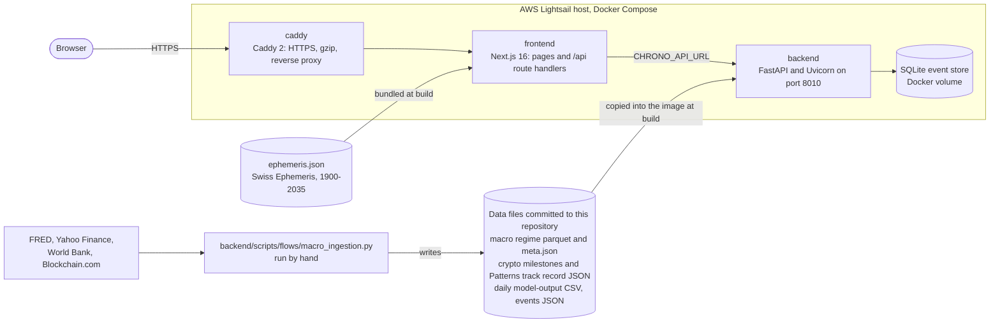

# StrikeHike

[strikehike.com](https://strikehike.com) is a research site that sets the US macro record beside the planetary sky, date by date. It charts NBER recession windows from 1854; market series for the S&P 500, gold, US Treasuries, the Nifty 50 and Bitcoin; and a −50 to +50 Core Index, decided weekly at the Friday close from December 1928, that reads the S&P 500's trend and volatility with credit spreads, unemployment and the yield curve as stress inputs, beside a separate trend warning (a Friday close below the 40-week average). It compares market declines from a catalogue found in that data, and sets the latest 12 months beside their closest historical setups. Separately, it shows the sidereal sky for any date from 13 July 1906 to 31 December 2027, from Swiss Ephemeris positions, and looks up historical events with similar planetary geometry. In the site's own words: research, not investment advice.

## Views

| View | Path | What it shows |
|---|---|---|
| Orrery | `/` | A 3D orrery of the sidereal sky (Lahiri) for any date and time (UTC) from 13 July 1906 to 31 December 2027. It lists the historical events whose planetary geometry is closest to that moment and shows a 0–100 energy gauge computed from the planetary geometry (see Data sources). |
| Regime | `/regime` | One market chart with every NBER recession window since 1854 and the weekly Core Index from December 1928 with its trend warning, comparing the S&P 500, gold, Treasuries and the Nifty 50 on a single percentage scale. |
| Convergence | `/convergence` | Any two market declines side by side, picked from the case catalogue (declines of US stocks, the Nifty 50, Bitcoin, gold and Treasuries found in the data): the fall from each peak, the macro reading on the same days and the Sun, Moon and Saturn positions at each peak. |
| Study of Patterns | `/patterns` | The latest 12 months of the S&P 500 or the Nifty 50 beside the closest past 12-month setups, what followed them a year later beside the usual rate, the S&P 500's 120-year mirror and the comparison's measured track record. |

`/disclaimer` gathers the site's disclaimers on one page, linked from the Orrery's Info panel and the footers of the three data views.

## Architecture



The browser only talks to Caddy, which proxies every request to the Next.js server. Pages and the route handlers under `frontend/src/app/api/` run there; the handlers call the FastAPI backend over the Compose network, and the backend's port is published on the host's loopback interface only. The backend serves read-only JSON from data files baked into its image, plus a SQLite event store that it seeds from `historical_events.json` when the store is missing or empty; it calls no external service while handling a request. New market data reaches the site when the ingestion flow is re-run and its output is committed and deployed.

```text
frontend/            Next.js app: the four views, /api route handlers, 3D scene, charts
backend/             FastAPI service, regime package, ingestion flow, data files
docker-compose.yml   production stack: backend, frontend, caddy
Caddyfile            HTTPS and reverse proxy for strikehike.com
.github/workflows/   deploy on push to main, plus two manual data workflows
```

## Stack

- **Frontend:** Next.js 16 (App Router, standalone output), React 19, Tailwind CSS 4, three.js with React Three Fiber and drei, TradingView Lightweight Charts, Zustand, Framer Motion, GSAP, next-themes. Node.js 22.
- **Backend:** Python 3.11, FastAPI, Uvicorn, Pydantic 2, pandas, NumPy, PyArrow, scikit-learn, pyswisseph (Swiss Ephemeris), SQLite, Requests, Loguru.
- **Infrastructure:** Docker Compose (services `backend`, `frontend`, `caddy`), Caddy 2, an AWS Lightsail host, GitHub Actions.

## Data sources

`backend/scripts/flows/macro_ingestion.py` fetches the market and macro series and writes `backend/data/processed/macro_regime_history.parquet` with a `.meta.json` file that records coverage and notes, lists each FRED series with its URL and labels the source of each asset series. The API reads those committed files.

| Data | Source |
|---|---|
| US macro series (rates, liquidity, inflation, growth, labour, housing, trade, fiscal) and the NBER recession indicator `USREC` | FRED (Federal Reserve Bank of St. Louis): the official API when `FRED_API_KEY` is set, otherwise FRED's public `fredgraph.csv` endpoint |
| ICE BofA US High Yield option-adjusted spread, one of the Core Index's credit stress inputs | FRED. Without an API key the CSV endpoint returns only the last three years, so the flow merges a public mirror of the full history (1996 onward) hosted as a GitHub gist |
| S&P 500 | Yahoo Finance `^GSPC` daily closes from 1927-12-30, preceded by the NBER/Cowles monthly index. Before 4 March 1957 `^GSPC` is the S&P 90, the S&P 500's predecessor. Where a Yahoo close differs from FRED's official close by more than half a cent (FRED covers the last ten years), the official close is used, and a reviewed list of isolated Yahoo misprints is dropped |
| Nifty 50 | Yahoo Finance `^NSEI` daily closes, from September 2007 |
| Gold | World Bank Commodity Price Data (Pink Sheet): the monthly London bullion price, forward-filled to daily |
| US Treasuries | A total-return proxy computed from FRED's 10-year Treasury yield (7.5-year duration) |
| Bitcoin | Blockchain.com market-price chart, daily from 2010-08-18 |
| Planetary positions | Swiss Ephemeris 2.10 via pyswisseph, Lahiri sidereal. `frontend/src/data/astro/ephemeris.json` (1900–2035) is generated by `frontend/scripts/generate-ephemeris.py`; the backend computes event geometry with pyswisseph |
| Historical events | `backend/data/historical_events.json`, a curated list seeded into SQLite |
| Crypto milestones | Hand-picked comparison windows in `backend/regime/crypto_milestones.py`; editorial, not statistically detected |
| Convergence cases | Computed from the parquet at request time by `backend/regime/cases.py`: declines on each market series found by one documented rule per market, with NBER recessions and dated events as context |
| Study of Patterns track record | `backend/data/processed/patterns_v2_skill.json`, written by the ingestion flow or `backend/scripts/patterns_v2_evidence.py`: the comparison re-run on past dates with only the history available then, and checked against what followed |
| Orrery energy gauge | Computed from the planetary geometry of the selected moment (hard aspects, planetary concentration, retrogrades) and ranked against the same score for the curated events, with fixed minimums of 92 to 97 on eight listed market-stress dates such as 1929-10-29 and 2008-09-15. Code: `backend/src/astro_finance/historical_parallels.py`, with `frontend/src/lib/astro/energy.js` as a fallback when the backend returns no score |
| Orrery tooltip, "Financial Market Volatility" | `backend/data/processed/final_data_with_regimes.csv`, a precomputed daily frame (1992-02-11 to 2025-01-01) from the earlier project's regime model |

**Licences and terms.** The ingestion code holds every source's URL, and `macro_regime_history.meta.json` lists each FRED series with its URL, but neither records a licence or terms of use for the data; check each provider's terms before reusing it. The planet textures in `frontend/public/textures/` come from Solar System Scope under CC BY 4.0 (see `ATTRIBUTION.md` in that folder).

## Run locally

You need Python 3.11 and Node.js 22, the versions CI and the Docker images use (CI and the backend image pin Python 3.11.9). No environment variables are required.

**Backend**, from `backend/` (the API opens `data/processed/final_data_with_regimes.csv` by a path relative to the working directory):

```bash
cd backend
python -m venv .venv
source .venv/bin/activate        # Windows: .venv\Scripts\activate
pip install -r requirements-minimal.txt
uvicorn api_server:app --port 8000
```

On first start the API builds the SQLite event store at `backend/data/historical_events.db` (git-ignored). Interactive API docs are at http://127.0.0.1:8000/docs.

**Frontend**, in a second terminal:

```bash
cd frontend
npm ci
npm run dev
```

Open http://localhost:3000. The route handlers call the backend at `CHRONO_API_URL`, which defaults to `http://127.0.0.1:8000`; to use another address, set it in `frontend/.env.local`. Optional backend settings are listed under [Configuration in `backend/README.md`](backend/README.md#configuration).

**With Docker.** `docker-compose.yml` is the production stack: its Caddy service binds ports 80 and 443 and serves only `strikehike.com` and `www.strikehike.com`. For local work, run the backend container on its own and the frontend as above:

```bash
docker compose up --build -d backend  # API on http://127.0.0.1:8010
cd frontend
CHRONO_API_URL=http://127.0.0.1:8010 npm run dev
```

(In PowerShell, set `$env:CHRONO_API_URL = "http://127.0.0.1:8010"` before `npm run dev`.)

**Refreshing the macro data** is optional:

```bash
cd backend
python -m scripts.flows.macro_ingestion
```

Without `FRED_API_KEY` the flow uses FRED's public CSV endpoint; with it, the official API (`--check-key` validates the key). The key is read from the environment, `backend/.env` or a `.env` at the repository root. Downloads are cached in `backend/data/raw/fred/` (git-ignored), and `--offline` rebuilds from that cache alone. The flow overwrites four files in `backend/data/processed/`: `macro_regime_history.parquet`, `macro_regime_history.meta.json`, `crypto_milestones.json` and `patterns_v2_skill.json` (the Study of Patterns track record; if that step fails, the old file stays and the flow logs a warning). A running API reloads the parquet file when it changes.

## Tests

CI runs the backend suite from `backend/` with `PYTHONPATH=src:.`:

```bash
cd backend
PYTHONPATH=src:. python -m pytest \
  tests/test_energy_metric_compiler.py \
  tests/test_historical_parallels.py \
  tests/test_macro_ingestion.py \
  tests/test_patterns.py \
  tests/test_regime_service.py \
  tests/test_regime_cases.py \
  -q
```

In PowerShell, set `$env:PYTHONPATH = "src;."` and pass the same file list. For the frontend, CI runs `npm run lint` and `npm run build` in `frontend/`; there are no frontend unit tests.

## Deployment

Every push to `main` runs [`.github/workflows/deploy-lightsail.yml`](.github/workflows/deploy-lightsail.yml). Only one run executes at a time (concurrency group `lightsail-production`, `cancel-in-progress: false`), so a newer push never cancels a deploy that is already running.

1. **Backend tests:** Python 3.11.9; upgrade pip, `pip install -r requirements-minimal.txt`, then the pytest modules listed above.
2. **Frontend lint and build:** Node 22; `npm ci`, `npm run lint`, `npm run build`.
3. **Deploy monorepo to Lightsail**, only when both jobs pass. Over SSH, on the Lightsail host, the job:
   1. fast-forwards the checkout to `origin/main`;
   2. builds the new images with `docker compose -p strikehike-chrono build` while the current site keeps serving;
   3. if containers from the older `strikehike` Compose project exist, takes that project down, or stops its containers when that is not possible, to free ports 80 and 443;
   4. starts the stack with `docker compose -p strikehike-chrono up -d --remove-orphans`;
   5. runs `docker system prune -a -f --filter "until=24h"` to reclaim disk space;
   6. waits 15 seconds for Caddy to provision its certificate, then probes, with retries, `http://127.0.0.1:8010/health`, `https://strikehike.com/` and `https://strikehike.com/api/chrono/positions?date=2008-09-15`, the last two resolved to the host itself;
   7. if step 4 or any probe fails, rolls back: runs `docker compose -p strikehike-chrono down --remove-orphans`, brings back the older `strikehike` containers if step 3 found any, and fails the job;
   8. once every probe passes, removes the older `strikehike` containers.

Two more workflows run only when started by hand. `macro-ingestion.yml` builds the macro artifact with the repository's `FRED_API_KEY` secret and uploads it as a workflow artifact; it does not commit anything. `reseed-historical-events.yml` runs `scripts/force_reseed_db.py` in the production backend container, which drops and rebuilds the SQLite event store from `historical_events.json`.

## Status

- strikehike.com is live and deploys from `main` through the workflow above.
- Added in October 2026: the daily S&P 500 history from Yahoo Finance described above, Core Index v2 with its trend warning, the Convergence case catalogue, Study of Patterns v2, the `/disclaimer` page and an interface polish pass across the four views.
- Older experiments from the earlier Astro Finance project (ML training and validation scripts, two microservices, Pine Script indicators, Prefect, Kubernetes and Prometheus configuration, and planning notes) were removed on 28 October 2026; git history keeps them. `backend/` still holds some of that project's code and data files, which strikehike.com does not use; [`backend/README.md`](backend/README.md#legacy-code-not-used-by-the-site) lists them.

## Disclaimer

**Research, not investment advice.** That is the site's own wording; [`/disclaimer`](https://strikehike.com/disclaimer) gathers the rest of its notes.
