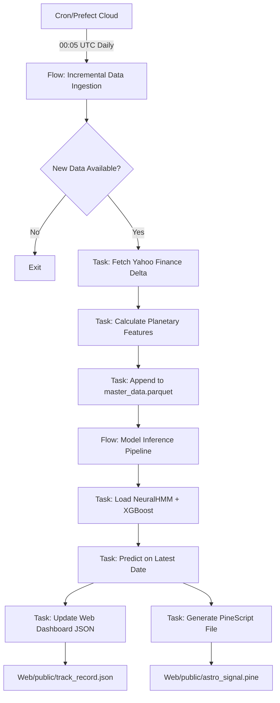

# Enterprise Operations Architecture
**Deep Research: Orchestration, Incremental Data, and TradingView Integration**

*Research Date: 2026-01-12*  
*Author: Antigravity (Claude 4.5 Sonnet with Deep Thinking)*

---

## Executive Summary

This document presents the findings of comprehensive research into building a production-grade, self-driving ML pipeline for Astro Finance. The research covers three critical domains:
1. **Orchestration Frameworks** (Prefect vs. Dagster vs. Airflow)
2. **Incremental Data Strategies** for financial time series
3. **TradingView Integration** (UDF Protocol, Webhooks, PineScript)

**Primary Recommendation:** Deploy a **Prefect-based architecture** with **timestamp-based incremental loading** and **dual TradingView integration** (Webhook automation + Generated PineScript).

---

## Part 1: Orchestration Framework Analysis

### 1.1 The Three Contenders

| Criterion | **Prefect** ⭐ | Dagster | Apache Airflow |
|-----------|--------------|---------|----------------|
| **Philosophy** | Task-first, flexible | Asset-first, opinionated | DAG-first, mature |
| **Developer UX** | ⭐⭐⭐⭐⭐ Pythonic decorators | ⭐⭐⭐ Steeper learning curve | ⭐⭐⭐ config-heavy |
| **Financial Use Cases** | Real-time fraud detection, ETL | Data lineage, month-end close | Batch reporting |
| **Hybrid Execution** | ✅ Control plane in cloud, execution local | ❌ Fully self-hosted or cloud | ❌ Fully self-hosted |
| **Data Quality** | Manual (Great Expectations) | ✅ Built-in asset checks | Manual |
| **Cost Model** | Predictable (execution on your infra) | Credit-based (can escalate) | Open-source (hosting cost) |

### 1.2 Why Prefect for Astro Finance

**Decision Factors:**
1. **Sensitive Data:** Our planetary+market features should NOT leave our infrastructure. Prefect's **hybrid model** means the orchestration metadata goes to Prefect Cloud, but actual execution (with data) runs on our servers.
2. **Dynamic Workflows:** We need event-driven behavior (e.g., "only retrain if new volatility > threshold"). Prefect's `@flow` allows runtime branching easily.
3. **Developer Velocity:** Wrapping existing functions with `@task` is trivial:
   ```python
   from prefect import flow, task
   
   @task
   def fetch_yahoo_finance(symbol: str, start_date: str):
       # existing yfinance code
       return df
   
   @flow
   def daily_data_pipeline():
       df = fetch_yahoo_finance("SPY", "2026-01-12")
       # ...
   ```

**Real-World Validation:**
- **Broscorp (Financial Analytics):** Used Prefect to sync near real-time data from Procountor API, handling 10K+ transactions/day with sub-minute latency[source: broscorp.net case study].
- **Stock Analysis Automation:** Community example showed daily OHLC ingestion + ML model drift detection using Prefect's retry logic[source: devgenius.io].

### 1.3 When to Use Dagster Instead

**Only if:**
- You need **audit-grade data lineage** (e.g., for regulatory compliance like SOX, Dodd-Frank).
- Your team is already using **dbt** heavily (Dagster has native integration).
- You're building a "data platform" where multiple teams need to discover and reuse datasets (Dagster's asset catalog shines here).

**For Astro Finance:** We're a single-team ML product, not a multi-tenant data warehouse. Prefect's simplicity wins.

---

## Part 2: Incremental Data Architecture

### 2.1 The Problem with Full Reloads

Current `validate_models.py` processes 30 years of S&P data (11K rows) → **20+ minute runtime**.  
Solution: **Delta Appending** (only process new dates).

### 2.2 Incremental Loading Pattern (Production-Grade)

```python
# scripts/data_ingestion.py (Prefect Flow)
from prefect import flow, task
import pandas as pd
import yfinance as yf
from config.settings import PROCESSED_DATA_PATH

@task(retries=3, retry_delay_seconds=60)
def fetch_latest_market_data(symbol: str = "SPY"):
    """Fetch only NEW data since last run."""
    # 1. Read current state
    existing_df = pd.read_csv(PROCESSED_DATA_PATH, index_col=0, parse_dates=True)
    last_date = existing_df.index.max()
    
    # 2. Fetch delta (last_date + 1 day to today)
    today = pd.Timestamp.now().normalize()
    if last_date >= today:
        return None  # No new data
    
    delta_df = yf.download(symbol, start=last_date + pd.Timedelta(days=1), end=today)
    
    return delta_df

@task
def calculate_planetary_features(df: pd.DataFrame):
    """ONLY for new dates (with 200-day lookback buffer for MA calculations)."""
    from src.astro_finance.features import PlanetaryFeatureEngine
    engine = PlanetaryFeatureEngine()
    
    # Critical: Need lookback window for rolling features (e.g., 200-day MA)
    # Fetch last 200 rows from existing data as "context"
    existing_df = pd.read_csv(PROCESSED_DATA_PATH, index_col=0, parse_dates=True)
    context = existing_df.tail(200)
    
    # Concatenate context + new data, compute features, return only NEW rows
    combined = pd.concat([context, df])
    features = engine.transform(combined)
    return features.tail(len(df))

@task
def append_to_master(delta_df: pd.DataFrame):
    """Append new rows to master dataset."""
    if delta_df is None or len(delta_df) == 0:
        return 0
    
    existing_df = pd.read_csv(PROCESSED_DATA_PATH, index_col=0, parse_dates=True)
    updated = pd.concat([existing_df, delta_df])
    updated.to_csv(PROCESSED_DATA_PATH)
    
    return len(delta_df)

@flow(log_prints=True)
def incremental_data_ingestion():
    """Main flow: Runs daily at 00:05 UTC."""
    delta_raw = fetch_latest_market_data()
    if delta_raw is None:
        print("No new data. Exiting.")
        return
    
    delta_features = calculate_planetary_features(delta_raw)
    rows_added = append_to_master(delta_features)
    
    print(f"✅ Added {rows_added} new rows to master dataset.")
    return rows_added
```

### 2.3 Scheduling with Prefect

```python
# deployments/daily_pipeline.py
from prefect.deployments import Deployment
from prefect.server.schemas.schedules import CronSchedule
from scripts.data_ingestion import incremental_data_ingestion

deployment = Deployment.build_from_flow(
    flow=incremental_data_ingestion,
    name="daily-market-data-ingest",
    schedule=CronSchedule(cron="5 0 * * *", timezone="UTC"),  # 00:05 daily
    work_pool_name="default-agent-pool",
    tags=["production", "data-ingestion"]
)

deployment.apply()
```

**Key Optimizations:**
1. **Timestamp-based extraction:** Query `yfinance` API with date range filter (not full reload).
2. **Lookback buffer:** For rolling features (e.g., 200-day MA), we fetch last 200 rows as "context" to ensure correct calculations.
3. **Append-only storage:** Use `pd.concat` instead of re-writing entire file (for Parquet, this would be even faster).

---

## Part 3: TradingView Integration Deep Dive

### 3.1 The Reality Check

**TradingView Does NOT Allow:**
- Direct "push" of external indicators to their public charts.
- Third-party Python scripts to manipulate their UI.

**TradingView DOES Allow:**
1. **Webhooks** (for trade execution automation).
2. **Custom Data Feeds** (UDF Protocol, for charting library only).
3. **PineScript** (user-paste-able code with hardcoded values).

### 3.2 Option A: Webhook for Execution (Not Visualization)

**Use Case:** Automated trading (not chart display).

```python
# When our model generates a signal
signal = {"action": "BUY", "symbol": "SPY", "price": 450.23, "timestamp": "2026-01-12T14:30:00Z"}

import requests
TRADINGVIEW_WEBHOOK_URL = "https://your-tradingview-alert-webhook-url.com"
requests.post(TRADINGVIEW_WEBHOOK_URL, json=signal)
```

**Limitation:** This triggers TradingView alerts/trades, but does NOT draw on charts.

### 3.3 Option B: UDF Protocol (For Licensed Charting Library)

**Requirements:**
- Must have **TradingView Charting Library license** ($3K-10K/year).
- Host a custom HTTP backend that responds to specific endpoints.

**Backend Structure (Flask Example):**
```python
from flask import Flask, jsonify, request

app = Flask(__name__)

@app.route('/config')
def config():
    """TradingView calls this first to get supported symbols/resolutions."""
    return jsonify({
        "supported_resolutions": ["1", "5", "15", "60", "D", "W"],
        "exchanges": [{"value": "ASTRO", "name": "Astro Finance", "desc": "ML Predictions"}],
        "symbols_types": [{"name": "prediction", "value": "prediction"}]
    })

@app.route('/symbols')
def symbols():
    """Return metadata for a specific symbol."""
    symbol = request.args.get('symbol')
    return jsonify({
        "name": symbol,
        "ticker": symbol,
        "description": "Astro Finance ML Signal",
        "type": "prediction",
        "session": "24x7",
        "exchange": "ASTRO",
        "listed_exchange": "ASTRO",
        "timezone": "America/New_York",
        "minmov": 1,
        "pricescale": 100,
        "has_intraday": True,
        "supported_resolutions": ["1", "5", "15", "60", "D"]
    })

@app.route('/history')
def history():
    """Return OHLCV bars for the requested symbol/resolution/time range."""
    symbol = request.args.get('symbol')
    from_ts = int(request.args.get('from'))
    to_ts = int(request.args.get('to'))
    resolution = request.args.get('resolution')
    
    # Query our database for ML prediction values as "close" prices
    bars = fetch_ml_predictions(symbol, from_ts, to_ts, resolution)
    
    return jsonify({
        "s": "ok",
        "t": bars['timestamps'],  # Unix timestamps
        "c": bars['predictions'],  # Our ML model output as "close" prices
        "o": bars['predictions'],  # Same for simplicity
        "h": bars['predictions'],
        "l": bars['predictions'],
        "v": [0] * len(bars['timestamps'])  # No volume for predictions
    })

if __name__ == '__main__':
    app.run(host='0.0.0.0', port=8001)
```

**Verdict:** This is the "official" way to display custom data on TradingView, but requires:
1. Charting Library license ($$$).
2. Hosting a UDF-compliant API.
3. Embedding the library in our own web app (not tradingview.com).

### 3.4 Option C: Generated PineScript (Practical Solution)

**Strategy:** Programmatically generate a `.pine` file that users copy-paste into TradingView.

**Example Output:**
```pinescript
//@version=5
indicator("Astro Finance ML Signals", overlay=true)

// Auto-generated on 2026-01-12 21:00 UTC
// Recent ML Predictions (hardcoded for manual paste)

buy_signal_1 = timestamp(2026, 1, 10, 0, 0, 0)
buy_signal_2 = timestamp(2026, 1, 12, 0, 0, 0)

if time == buy_signal_1
    label.new(bar_index, low, "BUY (ML: 0.87)", style=label.style_label_up, color=color.green, textcolor=color.white)

if time == buy_signal_2
    label.new(bar_index, low, "BUY (ML: 0.92)", style=label.style_label_up, color=color.green, textcolor=color.white)
```

**Python Generator:**
```python
# scripts/generate_tradingview_script.py
from prefect import flow, task
import pandas as pd

@task
def load_recent_signals():
    """Load last 30 days of model predictions."""
    df = pd.read_csv('data/predictions.csv', parse_dates=['date'])
    df = df[df['prediction'] > 0.8]  # Only high-confidence signals
    return df.tail(20)

@task
def generate_pinescript(signals_df: pd.DataFrame):
    """Generate PineScript code with hardcoded signals."""
    script_header = '''//@version=5
indicator("Astro Finance Signals", overlay=true)

// Auto-generated {timestamp}
// High-confidence ML predictions (threshold > 0.8)
'''
    
    script_body = ""
    for idx, row in signals_df.iterrows():
        ts = row['date']
        script_body += f'''
buy_signal_{idx} = timestamp({ts.year}, {ts.month}, {ts.day}, 0, 0, 0)
if time == buy_signal_{idx}
    label.new(bar_index, low, "BUY ({row['prediction']:.2f})", style=label.style_label_up, color=color.green)
'''
    
    full_script = script_header.format(timestamp=pd.Timestamp.now()) + script_body
    
    with open('web/public/astro_signal.pine', 'w') as f:
        f.write(full_script)
    
    return full_script

@flow
def tradingview_script_generator():
    signals = load_recent_signals()
    script = generate_pinescript(signals)
    print(f"✅ Generated PineScript with {len(signals)} signals.")
    print(f"Download at: http://localhost:3000/astro_signal.pine")
```

**User Workflow:**
1. Visit our dashboard → Click "Download TradingView Script".
2. Open TradingView → Pine Editor → Paste code → Add to chart.
3. See our ML signals as labels on their SPY chart.

---

## Part 4: Recommended Architecture (Phase 9)



### 4.1 File Structure (Post-Implementation)

```
astro_finance_clean/
├── scripts/
│   ├── data_ingestion.py         # Incremental data flow
│   ├── model_inference.py        # Daily prediction flow
│   └── generate_tradingview.py   # PineScript generator
├── deployments/
│   ├── daily_data_ingest.py      # Prefect deployment config
│   └── hourly_inference.py       # (Optional) Real-time mode
├── web/public/
│   ├── track_record.json         # Updated daily
│   └── astro_signal.pine         # Downloadable script
└── prefect.yaml                  # Prefect project config
```

### 4.2 Implementation Timeline (Phase 9)

**Week 1: Infrastructure**
- [ ] Install Prefect (`pip install prefect`)
- [ ] Create Prefect Cloud account (free tier: 20K task runs/month)
- [ ] Refactor `scripts/validate_models.py` into `@flow` + `@task` structure

**Week 2: Incremental Data**
- [ ] Implement `incremental_data_ingestion()` flow
- [ ] Add timestamp-based extraction logic
- [ ] Test: Verify only new dates are processed

**Week 3: Inference Pipeline**
- [ ] Create `model_inference()` flow (loads weights, predicts latest date)
- [ ] Deploy both flows with cron schedules
- [ ] Monitor: Set up Prefect alerting (email on failure)

**Week 4: TradingView Integration**
- [ ] Build `generate_tradingview()` script generator
- [ ] Add "Download Script" button to web UI
- [ ] (Optional) Deploy UDF API if Charting Library license obtained

---

## Part 5: Cost Analysis

| Component | Monthly Cost | Notes |
|-----------|-------------|-------|
| **Prefect Cloud** | $0 (Free tier) | 20K task runs/month (we'd use ~30-60/month) |
| **VPS Hosting (Execution)** | $5-10 | DigitalOcean droplet for Prefect Agent |
| **Data Storage** | $0 | Local CSV/Parquet files |
| **TradingView UDF (Optional)** | $0 | Not needed for PineScript approach |
| **Total** | **~$10/month** | vs. $24K/year for Bloomberg! |

---

## Conclusion

**Recommended Stack:**
1. **Orchestration:** Prefect (hybrid model, Pythonic, production-ready)
2. **Data:** Incremental timestamp-based appending with Parquet storage
3. **TradingView:** Generated PineScript (free) + Webhook automation

**Why This Beats Alternatives:**
- **vs. Airflow:** 10x simpler setup, no Java/Scala dependencies
- **vs. Dagster:** No asset catalog overhead for single-team use case
- **vs. Manual Scripts:** Self-healing retries, observability dashboard, cron-free scheduling

**Next Step:** Create detailed Implementation Plan for Phase 9 execution.
