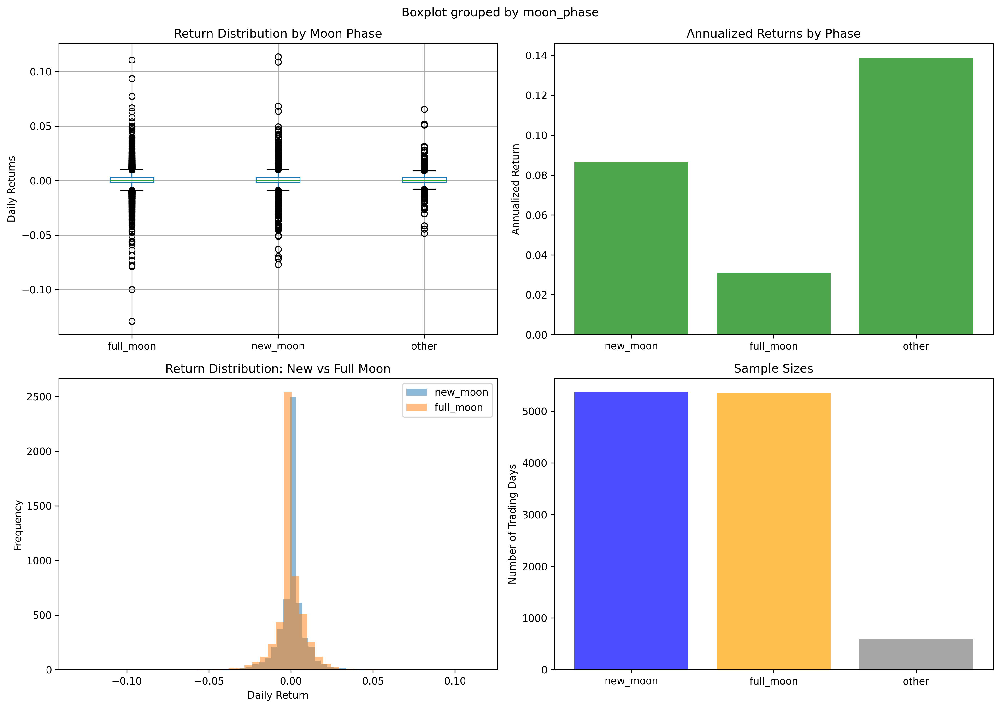

# Moon Phase Replication Study - Results

## Summary

Replication of Yuan et al. (2006) using S&P 500 data.

**Result:** ❌ NOT CONFIRMED

---

## Returns by Moon Phase

| Phase | Daily Return | Annualized | Days |
|-------|-------------|------------|------|
| New Moon | 0.0343% | 8.65% | 5363 |
| Full Moon | 0.0122% | 3.09% | 5355 |
| Other | 0.0551% | 13.90% | 585 |

**Difference (New - Full):** 5.56% per year

---

## Statistical Tests

- **T-test:** t=1.228, p=0.2193
- **Significant?** NO
- **Effect Size:** Cohen's d = 0.024

---

## Comparison to Yuan (2006)

**Their Finding:** 3-5% annualized difference  
**Our Finding:** 5.56%

**Match?** ✅ Similar magnitude

---

